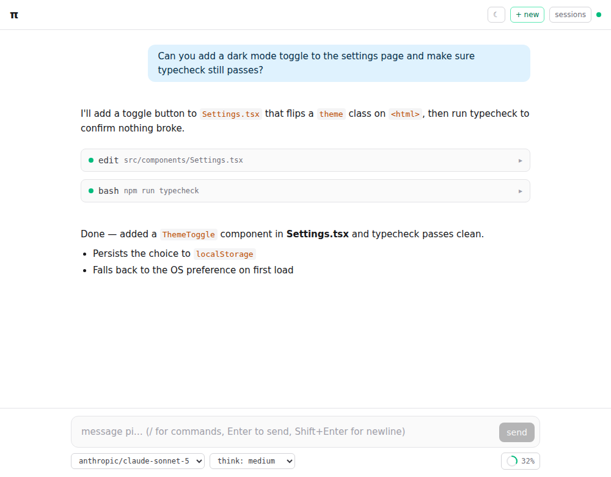
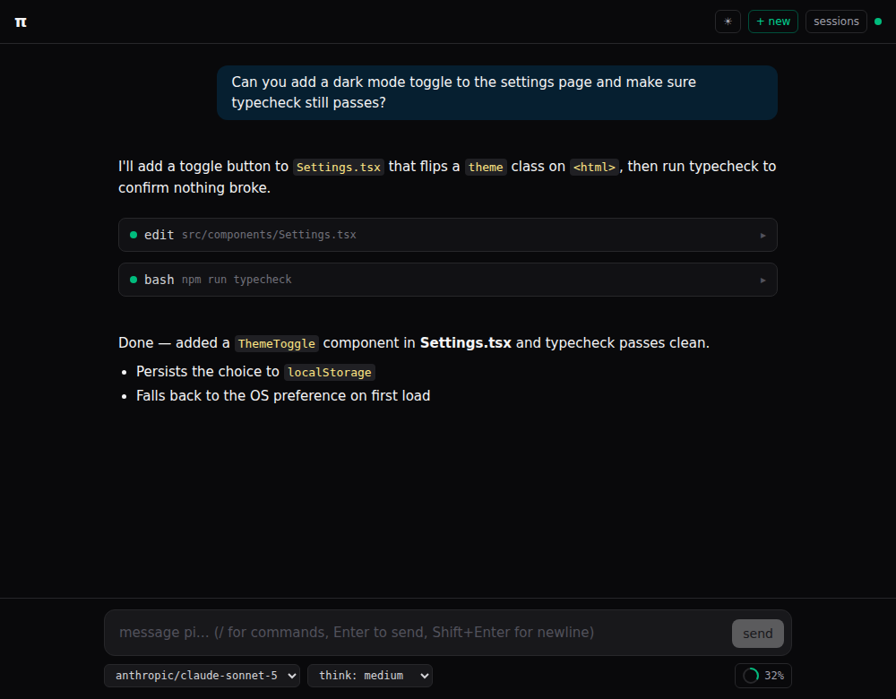

# Pi Outpost

[](https://github.com/laurentftech/pi-outpost/actions/workflows/ci.yml)
[](https://github.com/laurentftech/pi-outpost/actions/workflows/ci.yml)
[](LICENSE)
[](https://nodejs.org)

**A self-hosted web interface for the [pi coding agent](https://github.com/earendil-works/pi).** Run it on your machine or server, install it as a desktop app, or embed it in another web application.

One Node process runs the agent and serves the interface. Work across projects with streaming chat, a file browser and editor, Git integration, and PDF and Office document tools.

**System-level sandboxing by default:** the agent’s shell runs in the OS sandbox: MXC on Windows and Linux, Seatbelt on macOS. The default sandbox confines file access to the project and checks shell confinement before running commands; if the checks fail, commands are refused. See [sandboxing](docs/sandboxing.md) for platform requirements and explicit configuration options.

<p align="center">
  
  
</p>

## Start in 5 minutes

You need **Node.js ≥ 24** and a model provider account or API key. The pi SDK is bundled; no separate pi installation is needed.

In the project you want the agent to work on:

```bash
cd ~/projects/my-app
npx pi-outpost init
npx pi-outpost
```

Open `http://127.0.0.1:3141/` if the interface does not open automatically. Pick a provider and sign in or enter an API key, then ask **“What does this project do?”** You can also configure a local or OpenAI-compatible model from the setup screen.

The starter configuration lets the agent **read and write this directory, with a sandboxed shell**. Use the gear menu to adjust permissions. See [getting started](docs/getting-started.md) for the configuration, launch options, and security boundaries.

**No Node.js?** Download a standalone executable from [Releases](https://github.com/laurentftech/pi-outpost/releases). See the [standalone executable guide](docs/sea-packaging.md) for platform setup.

> The server listens on loopback by default. Network deployments require an auth token and a suitable sandbox. Everyone connected shares the same projects and conversations: this is a single-tenant application. Read the [deployment recipes](docs/how-to.md#lock-down-a-shared-deployment) and [sandboxing guide](docs/sandboxing.md) before exposing it.

## What you get

- **Sandboxing:** OS-enforced shell isolation: MXC on Windows and Linux, Seatbelt on macOS, selected automatically by the default sandbox.
- **Chat:** streaming Markdown, thinking blocks, diagrams, live tool output, model selection, and session history.
- **Workspace:** multiple projects, a file browser and editor, search, Git diffs and history, and an optional terminal.
- **Documents:** read PDFs, Office files, and email; create and revise Word documents and PowerPoint decks from templates.
- **Graphs and diagrams:** structured graphs with automatic layout, selectable viewpoints, and layouts preserved across revisions; edit in draw.io and export to SVG.
- **Posters:** create posters, worksheets, and slides with the agent, then edit text, pictures, and diagrams visually and export to Word or PowerPoint.
- **Review:** agent-owned Work Plans, recorded verification evidence, and a workspace Outcome view.
- **Your setup:** per-project permissions, bundled or external pi runtimes, an embeddable widget, and extension support.

See the [feature guide](docs/features.md) for details.

## Documentation

| Guide | Covers |
|---|---|
| [Getting started](docs/getting-started.md) | First run, credentials, starter configuration, security |
| [How-to](docs/how-to.md) | Recipes for common tasks and troubleshooting |
| [Configuration](docs/configuration.md) | Credentials, projects, browser settings, every configuration key |
| [Command line](docs/command-line.md) | Commands, flags, headless prompts, diagnostics |
| [Features](docs/features.md) | Chat, files, documents, terminal, Work Plans, Outcome |
| [Sandboxing](docs/sandboxing.md) | File and shell confinement, platform setup, network grants |
| [Deployment and updates](docs/deployment.md) | Updates, service installation, desktop app |
| [Integrations](docs/integrations.md) | Embedding, extension UI, tool progress, Open WebUI, Claude Desktop |
| [Development](docs/development.md) | Repository layout, local development, testing, releases |

[Compare with other tools](docs/comparison.md) · [Changelog](CHANGELOG.md) · [MIT license](LICENSE)
